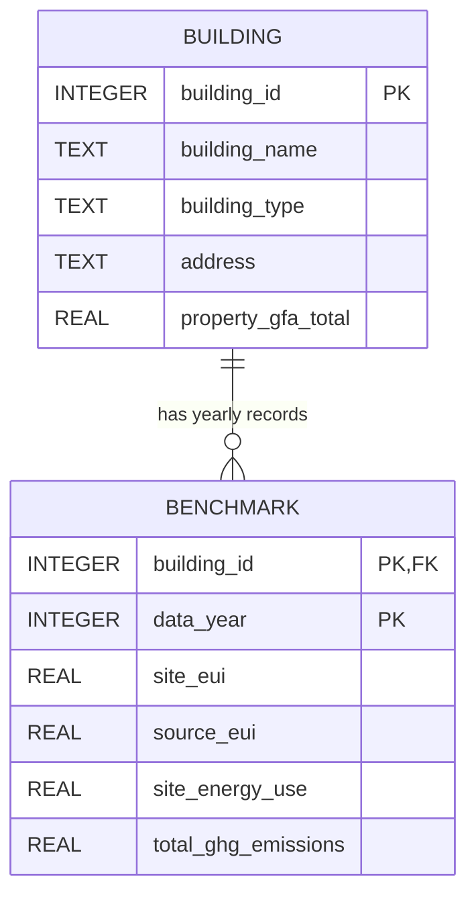

# Final Documentation – Database Schema and ER Diagram

This document summarizes the database structure used in Activity 2. The database contains two tables: `Building` and `Benchmark`.

## 1. Database Schema

### Building Table

| Column | Data type | Key | Description |
|---|---|---|---|
| `building_id` | INTEGER | PK | Unique identifier for each building |
| `building_name` | TEXT | — | Name of the building |
| `building_type` | TEXT | — | Building classification |
| `address` | TEXT | — | Building address |
| `property_gfa_total` | REAL | — | Total property gross floor area |

### Benchmark Table

| Column | Data type | Key | Description |
|---|---|---|---|
| `building_id` | INTEGER | PK, FK | Building identifier; references `Building.building_id` |
| `data_year` | INTEGER | PK | Reporting year |
| `site_eui` | REAL | — | Site Energy Use Intensity |
| `source_eui` | REAL | — | Source Energy Use Intensity |
| `site_energy_use` | REAL | — | Site energy use |
| `total_ghg_emissions` | REAL | — | Total greenhouse gas emissions |

**Composite primary key:** The `Benchmark` table uses (`building_id`, `data_year`) together as its primary key. This allows one building to have one benchmarking record per reporting year.

## 2. Entity-Relationship (ER) Sketch



**Relationship:** One `Building` can have zero or many `Benchmark` records. Each `Benchmark` record belongs to exactly one `Building`.

## 3. Key Explanation

- **Building primary key (`building_id`):** Identifies each building record uniquely.
- **Benchmark composite primary key (`building_id`, `data_year`):** Identifies each building-year record uniquely. `building_id` alone is not unique in Benchmark because a building can appear in multiple reporting years.
- **Benchmark foreign key (`building_id`):** References `Building.building_id` and connects annual benchmarking records to the corresponding building.
- **Relationship type:** One-to-many (Building → Benchmark).

## 4. Evidence and Validation

The database contains **3,871 Building records** and **38,309 Benchmark records**.

The join validation found:
- INNER JOIN result: **38,309 rows**
- LEFT JOIN result: **38,309 rows**
- Benchmark records without a matching Building: **0**
- Buildings without a Benchmark record: **0**

These results support the one-to-many relationship and show that all Benchmark records matched a Building record in the tested join.

## 5. Database Creation SQL

The tables were created using the following SQLite statements:

```sql
CREATE TABLE IF NOT EXISTS Building (
    building_id INTEGER PRIMARY KEY,
    building_name TEXT,
    building_type TEXT,
    address TEXT,
    property_gfa_total REAL
);

CREATE TABLE IF NOT EXISTS Benchmark (
    building_id INTEGER NOT NULL,
    data_year INTEGER NOT NULL,
    site_eui REAL,
    source_eui REAL,
    site_energy_use REAL,
    total_ghg_emissions REAL,
    PRIMARY KEY (building_id, data_year),
    FOREIGN KEY (building_id)
        REFERENCES Building(building_id)
);
```
